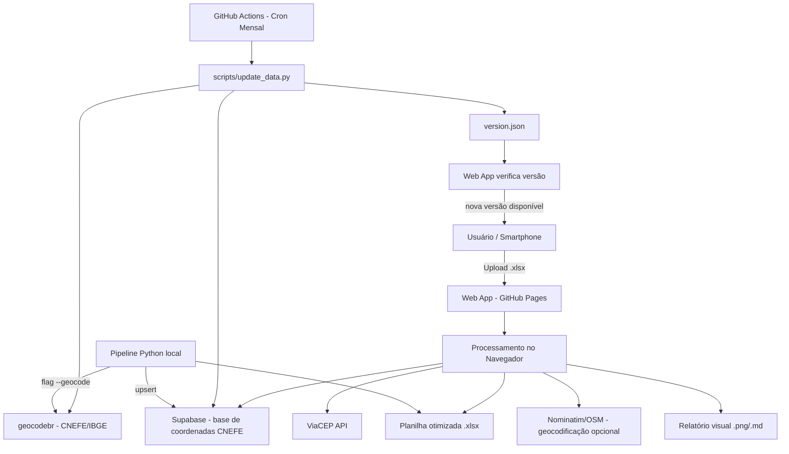

# Rota de Entrega — Versão Automatizada

Versão automatizada da ferramenta de auditoria, consolidação e otimização de rotas de entrega.
Mantém tudo o que já existe no projeto original e adiciona **atualização automática dos dados** (cron mensal) e **verificação de versão** no aplicativo web.

## Organograma (Arquitetura)



## Componentes

1. **Web App (GitHub Pages)** — `index.html`
   - Upload de planilha, processamento no navegador, download dos arquivos.
   - Consulta ViaCEP e, opcionalmente, Supabase (alta precisão CNEFE) ou Nominatim.
   - Verifica `version.json` e avisa quando há nova versão dos dados.
   - Após processar, faz upsert dos endereços no Supabase (sem apagar dados anteriores).

2. **Pipeline Python** — `scripts/run_pipeline.py`
   - Auditoria, padronização, ViaCEP, consolidação, planilha final, relatório.
   - Flag `--geocode` para usar `geocodebr` (CNEFE/IBGE) para coordenadas precisas.
   - Upsert no Supabase se `SUPABASE_URL` e `SUPABASE_KEY` estiverem configurados.

3. **Atualização Automática** — `.github/workflows/update-data.yml`
   - Cron mensal (dia 1, 03:00 UTC).
   - Roda `scripts/update_data.py`: baixa CNEFE, filtra por município, atualiza Supabase e `version.json`.
   - Totalmente automático (sem intervenção humana).

4. **Base de dados** — Supabase (tabela `enderecos`)
   - Armazena endereços+coordenadas do CNEFE por município.
   - Upsert (não apaga dados anteriores) ao processar novas cidades.
   - Leitura pública via anon key (segura para frontend).

## Supabase (configuração única)

1. Crie um projeto no Supabase.
2. Crie a tabela:
   ```sql
   create table enderecos (
     cep text, logradouro text, numero text, bairro text,
     lat double precision, lon double precision,
     primary key (cep, logradouro, numero)
   );
   ```
3. Ative RLS com política de leitura pública (anon key).
4. Adicione os secrets no GitHub: `SUPABASE_URL`, `SUPABASE_KEY`.
5. No `index.html`, preencha `SUPABASE_URL` e `SUPABASE_KEY`.

**Ao subir uma planilha de uma nova cidade**, os endereços são automaticamente adicionados (upsert) ao Supabase, sem apagar os dados anteriores.

## Como usar

### Web (smartphone ou desktop)
Acesse: https://marcosantoniosantos.github.io/rota-entrega-auto/

### Pipeline Python
```bash
python scripts/run_pipeline.py planilha.xlsx
# com geocodificação precisa (geocodebr):
python scripts/run_pipeline.py planilha.xlsx --geocode
# com upsert no Supabase:
SUPABASE_URL=... SUPABASE_KEY=... python scripts/run_pipeline.py planilha.xlsx
```

## Requisitos

- Python 3.10+ (pipeline)
- Navegador moderno (web app)
- (Opcional) geocodebr para máxima precisão
- (Opcional) Supabase para base de coordenadas

## Repositório original

Este projeto mantém o original intacto: https://github.com/MarcosAntonioSantos/rota-entrega-tool
EOF